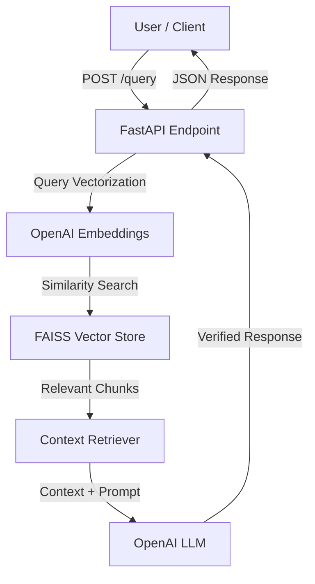

# Enterprise RAG Knowledge Assistant API

Production-ready, asynchronous RAG (Retrieval-Augmented Generation) microservice built with **FastAPI**, **LangChain**, and **FAISS**.

## 🏗 Architecture Overview



## 🚀 Key Features

- **Asynchronous REST API:** High-performance request handling using FastAPI.
- **Vector Store Integration:** Fast vector search and similarity retrieval powered by FAISS.
- **Modular Codebase:** Clean separation of concerns with `app/config.py` and `app/main.py`.
- **Strict Environment Management:** Configuration and API keys managed safely via `pydantic-settings`.

## 🛠 Tech Stack

- **Framework:** FastAPI
- **Orchestration:** LangChain
- **Vector Store:** FAISS
- **LLM & Embeddings:** OpenAI (GPT-4 / text-embedding-3-small)
- **Data Validation:** Pydantic v2

## ⚙️ Getting Started

### 1. Clone the Repository
```bash
git clone [https://github.com/alsualiyevas/RAG-with-Langchain-and-FastAPI.git](https://github.com/alsualiyevas/RAG-with-Langchain-and-FastAPI.git)
cd RAG-with-Langchain-and-FastAPI
```

### 2. Install Dependencies
```bash
pip install -r requirements.txt
```

### 3. Set Up Environment Variables
Create a `.env` file in the root directory:
```env
OPENAI_API_KEY=your_openai_api_key_here
```

### 4. Run the API
```bash
uvicorn app.main:app --reload
```
Access interactive Swagger docs at `http://127.0.0.1:8000/docs`.
